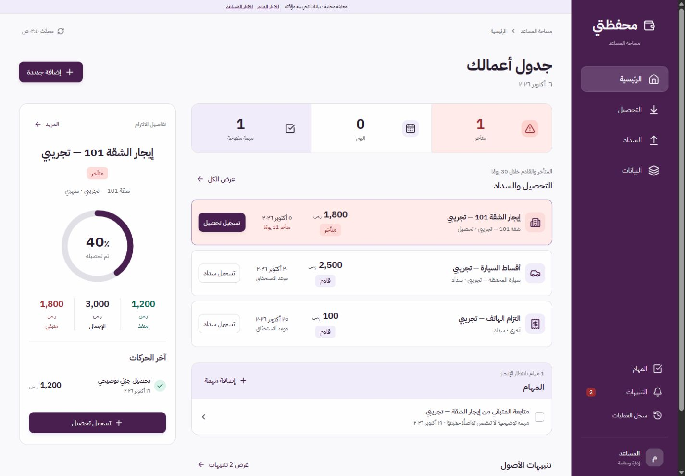
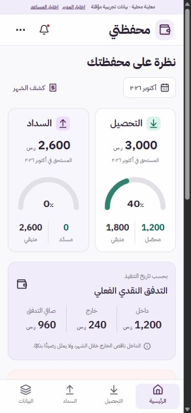
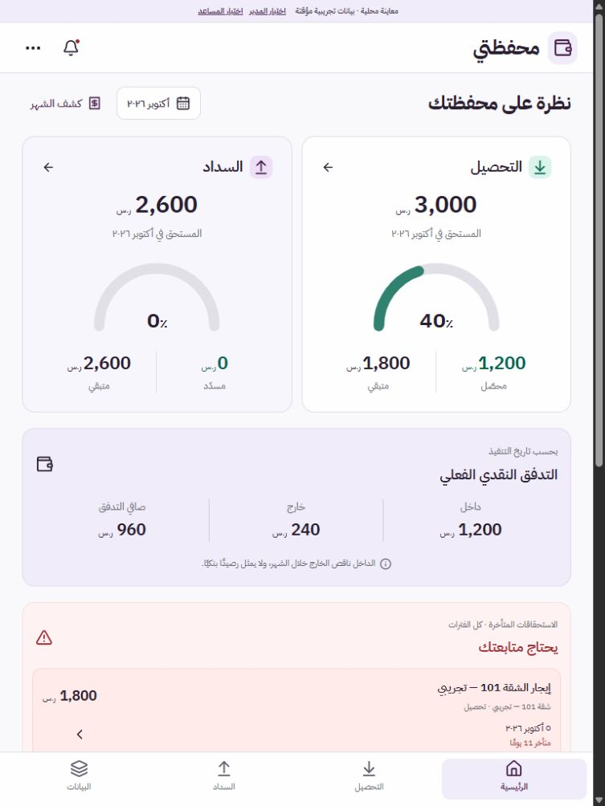

# قبول واجهة محفظتي 2.0

بتاريخ 16 أكتوبر 2026. الاتجاه المعتمد: «إيقاع واضح». جميع بيانات التجربة صناعية ومؤقتة، ولم يُنفذ نشر إنتاجي.

## نتيجة الاختبارات

- 72 اختبار Node ناجحًا: API، الصلاحيات، المصادقة، الحساب بالهللات، التزامن، الإغلاق والأرشفة، التاريخ، التصدير، وبناء الإنتاج والمعاينة.
- 28 اختبار React ناجحًا: نماذج المال، المدخلات الدقيقة، التصحيح، النسخ المتعارضة، إعادة المحاولة، المسودات، البحث، المهام، الكشف، وتعارض تحميل الأشهر.
- بناء Vite الإنتاجي ناجح، بخطوط محلية وبدون بيانات المعاينة أو واجهة JavaScript القديمة.
- بناء المعاينة المستقلة ناجح: JavaScript وCSS والخطوط مدمجة في `معاينة_تفاعلية.html`.
- تجميع Cloudflare Worker بواسطة `wrangler deploy --dry-run` ناجح. هذا تجميع محلي، وليس نشرًا.

## التحقق في المتصفح

اختُبرت الواجهة الفعلية في متصفح Codex، عبر API الأصلي وقاعدة SQLite في الذاكرة:

| الحالة | النتيجة |
| --- | --- |
| تسجيل تحصيل 100.10 ثم تصحيحه إلى 100.20 | تغير المتبقي من 1,800 إلى 1,699.90 ثم 1,699.80، دون إضافة حركة ثانية عند التصحيح |
| حذف حركة الاختبار | عاد المتبقي إلى 1,800، وبقي أثر الإضافة والتصحيح والحذف في السجل |
| البحث عن `١٠١` | ظهرت الوحدة المطابقة وعقارها، دون فقد الارتباط |
| إغلاق نموذج معدل بـEscape ثم متابعة الإدخال | بقي النص المدخل كما هو |
| تفاصيل الالتزام على الجوال | تفتح نافذة التفاصيل بدل اختيار لوحة جانبية مخفية |
| المدير | لا تظهر له أزرار تسجيل التحصيل أو السداد |
| مبلغ 1,000,000.25 على شاشة ضيقة | اختُبر، وأُصلح تمدد المبلغ خارج البطاقة |
| عروض 320،390،768،1024،1440 بكسل | لا يوجد تمدد أفقي للصفحة في شاشات الملخص المفحوصة |
| شاشة كمبيوتر بارتفاع 650 بكسل | الشريط الجانبي قابل للتمرير للوصول إلى جميع الأدوات |
| أخطاء JavaScript في المتصفح | لم تظهر أخطاء أو تحذيرات خلال الجولة النهائية |

أعيد تشغيل قاعدة المعاينة بعد هذه التجارب لمسح حركات الاختبار. المعاينة الحالية على `http://127.0.0.1:43130/`، وتوفر اختيار الدور من الشريط العلوي. يتوقف هذا الرابط المحلي عند إيقاف خادم التجربة.

## لقطات من التنفيذ الفعلي

## الحدود

اختبارات المقاسات داخل المتصفح لا تعني اختبار هاتف مادي أو كل إصدارات Safari وAndroid. فُحص منطق CSV والكشف، ولم تُنفذ طباعة ورقية. لم تُختبر Cloudflare Access وD1 على استضافة فعلية؛ لا يزال معرّف D1 وإعداد الحسابين مطلوبين قبل النشر. تبقى الملفات المالية الأصلية في `src` والترحيلات دون تغيير في هذا التحديث.
